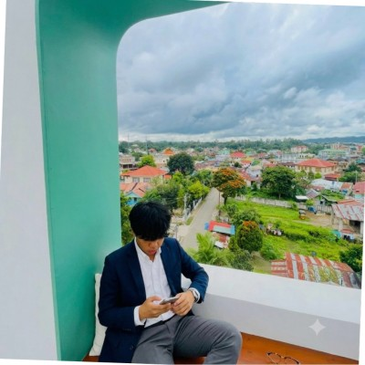
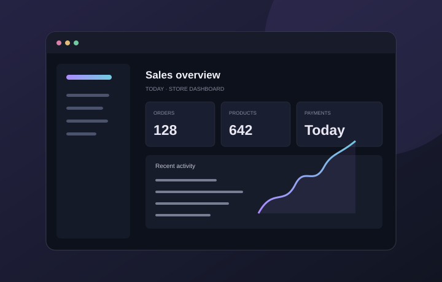

# Thwin Htoo Aung — Portfolio

A responsive, single-page developer portfolio built with plain HTML, CSS, and JavaScript. It presents my background, skills, selected project concepts, and a simple contact form that opens the visitor's email app — no backend or build step required.

## At a glance — what is this project?

| | |
| --- | --- |
| **Project** | Thwin Htoo Aung — Portfolio |
| **Type** | Static single-page developer portfolio — plain HTML/CSS/JavaScript |
| **What it does** | Hero, skills, filterable project cards, contact link that opens the visitor's e-mail app, light/dark theme, mobile-friendly navigation |
| **Tech** | HTML5 + CSS3 + vanilla JavaScript (DOM APIs, IntersectionObserver, `localStorage`) · Google Fonts · SVG/JPEG assets · no dependencies |
| **Ports** | No build step — open `index.html` directly. Optionally: `python -m http.server 8000` → `http://localhost:8000` |
| **Status** | No backend or API keys. The contact form opens an e-mail app rather than submitting to a server. |

In short: A responsive one-page developer portfolio built with plain HTML, CSS and JavaScript — background, skills, filterable project cards, light/dark theme and an e-mail-app contact link. No backend, build step or dependencies.


## Visual guide — what each image is

| Image | What it shows / where it is used |
| --- | --- |
|  | **`images/og-preview.png`** — the custom 1200×630 card used by the Open Graph / Twitter meta tags when this page is shared on social media. It is not a page screenshot. |
|  | **`images/profile1.jpg`** — the real portrait displayed in the hero section's circular avatar. |
|  | **`images/project-1.svg`** — a lightweight vector illustration of a sales dashboard; it previews the *Supermarket POS System* concept card. It is an illustration, not a screenshot of a deployed app. |
|  | **`images/project-2.svg`** — an illustrated editorial/blog layout for the *Blog Website* concept card. |
|  | **`images/project-3.svg`** — an illustrated management dashboard for the *Fitness Management System* concept card. |
|  | **`images/profile.svg`** — the small `T.` mark used as the browser tab icon (favicon). |

## Highlights

- **Responsive layout** — adapts from desktop to tablet and mobile, with a collapsible navigation menu.
- **Light / dark theme** — toggle with the saved preference remembered in `localStorage`.
- **Animated hero** — typed role text, subtle floating "code card" artwork, and scroll-triggered reveal effects.
- **Filterable projects** — browse selected work by JavaScript, Database, or PHP.
- **Accessible details** — skip link, ARIA labels on interactive controls, `aria-current` for the active section, reduced-motion support, and semantic landmarks.
- **SEO & sharing ready** — descriptive meta tags plus Open Graph / Twitter card metadata with a custom social preview image.
- **Zero dependencies** — no framework, no bundler, no API keys.

## Tech stack

| Layer | Technology |
| --- | --- |
| Markup | HTML5 |
| Styling | CSS3 (custom properties, grid, flexbox, animations) |
| Behaviour | Vanilla JavaScript (DOM APIs, IntersectionObserver, `localStorage`) |
| Typography | Manrope & DM Mono via Google Fonts |
| Assets | SVG illustrations, JPEG portrait, PDF CV |

## Run locally

No installation is needed. Open `index.html` directly in a browser, or serve the folder:

```bash
# From the repository root
python -m http.server 8000
# then visit http://localhost:8000
```

Google Fonts are loaded from the web, so an internet connection is needed for the intended typography; the page falls back to system fonts offline.

## Project structure

```text
.
├── index.html          # All page sections and metadata
├── css/style.css       # Design system, layout, themes, animations
├── js/script.js        # Theme, navigation, typing, filters, form validation
├── images/
│   ├── og-preview.png  # Social share preview (1200 × 630)
│   ├── profile1.jpg    # Portrait used in the hero
│   ├── profile.svg     # Favicon
│   ├── project-1.svg   # POS concept illustration
│   ├── project-2.svg   # Blog concept illustration
│   └── project-3.svg   # Fitness concept illustration
└── Thwin CV.pdf        # Downloadable CV
```

## Customising

- Update personal details, social links, project cards, and the CV link in `index.html`.
- Replace the portrait in `images/profile1.jpg` and regenerate `images/og-preview.png` when the name or role changes.
- Adjust colours, spacing, and the light/dark palettes through CSS custom variables at the top of `css/style.css`.
- The contact form validates input in `js/script.js` and then opens `mailto:htoothwin055@gmail.com` — change that address if needed. Nothing is sent or stored by the page itself.

## Other projects by the author

### Published on GitHub

| Project | What it is |
| --- | --- |
| [Boxing-Management-System](https://github.com/thwinthwin-spec/Boxing-Management-System) | Role-based PHP/MySQL boxing gym management system |
| [Clothing-Website](https://github.com/thwinthwin-spec/Clothing-Website) | Express/EJS clothing store with OTP registration, cart and admin area |
| [coffee_project](https://github.com/thwinthwin-spec/coffee_project) | Static multi-page coffee-shop website concept |
| [Node.js](https://github.com/thwinthwin-spec/Node.js) | Express/MySQL student-management learning demo |
| [LaravelFirstproject](https://github.com/thwinthwin-spec/LaravelFirstproject) | First Laravel app with authentication flow |
| [Boxing](https://github.com/thwinthwin-spec/Boxing) | Placeholder repo reserved for a future project |

### Local projects (not published yet)

| Project | What it is |
| --- | --- |
| Hotel Booking App | Three-app system: Node/Express/MongoDB API, Expo mobile app and React/Vite admin panel |
| Table & Thyme — Restaurant POS | MERN point of sale with kitchen board, KPay/Cash receipts and sales reports |

The three illustrated cards on the portfolio page itself are **concept previews**; the projects above are the author's actual repositories and local work.

## Contact

- GitHub: [thwinthwin-spec](https://github.com/thwinthwin-spec)
- LinkedIn: [jinn-n-813b61395](https://www.linkedin.com/in/jinn-n-813b61395)
- Email: htoothwin055@gmail.com

## License

Released under the [MIT License](LICENSE).

## Author

Thwin Htoo Aung — junior full-stack web developer based in Myanmar.
